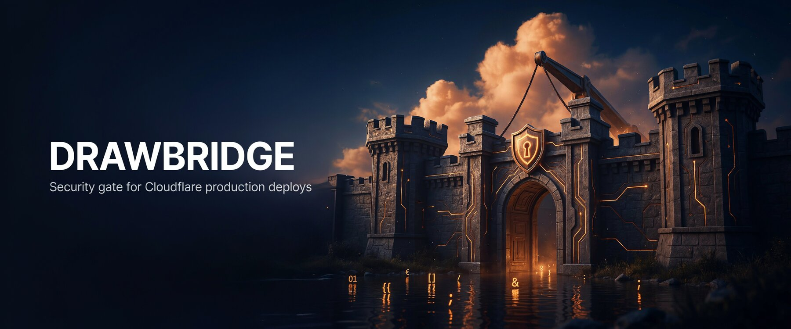
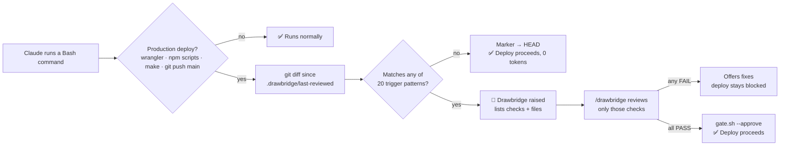

<p align="center">
  
</p>

<p align="center">
  <b>A Claude Code skill that raises the drawbridge before every Cloudflare production deploy,<br>
  and lowers it only when the changes since your last reviewed deploy are clean.</b>
</p>

<p align="center">
  
  
  
  
  
</p>

---

## Why Drawbridge?

Full security reviews on every deploy are slow and burn tokens on code that hasn't changed. Skipping them is how a `?next=` open redirect or a missing RLS policy ships on a Friday.

Drawbridge splits the work in two:

| | **The gate** (`gate.sh`) | **The review** (`/drawbridge`) |
|---|---|---|
| Runs | Before every Bash command, as a Claude Code hook | Only when the gate finds something |
| Costs | **0 tokens.** It's bash, git and awk | A few thousand tokens, limited to flagged checks and diff hunks |
| Does | Spots prod deploys, diffs since the last reviewed deploy, and matches 20 trigger patterns | Gives PASS / FAIL / NEEDS-HUMAN per flagged check in under 25 lines |

A README typo deploys straight through. A change to your login route triggers checks **#5 credential stuffing** and **#20 user enumeration**, and nothing else.

## How it works



What Claude sees when the gate fires:

```text
DRAWBRIDGE RAISED in /home/me/app: changes in 9f3c2e1 match the checks below. Production deploy is blocked until they are reviewed.
  5: app/api/login/route.ts
  20: app/api/login/route.ts
Run /drawbridge for checks 5,20 only. Diff: git -C /home/me/app diff -U15 9f3c2e1 -- <files>
After an all-PASS review, approve with: /home/me/app/.claude/skills/drawbridge/gate.sh --approve /home/me/app
```

And the review that follows:

```text
#5  FAIL app/api/login/route.ts:4 — no rate limit on POST /login — fix: add a Workers Rate Limiting binding keyed on IP + email
#20 FAIL app/api/login/route.ts:9 — "User not found" (404) vs "Wrong password" (401) — fix: return one generic 401 for both
```

## The 20 checks

| # | Vulnerability | Triggered by |
|--:|---|---|
| 1 | Next.js middleware bypass (`x-middleware-subrequest`) | `middleware.*`, `next` version bumps |
| 2 | `.git` / dotfiles served | `public/`, build output config, `.assetsignore` |
| 3 | Supabase storage exposure | `storage.from(`, bucket policies |
| 4 | Price trusted from the browser | checkout / cart / stripe routes, `price`/`amount`/`total` in API code |
| 5 | Credential stuffing | login routes, rate limit config, Turnstile |
| 6 | Open database | migrations, RLS, `service_role`, anon key, D1 / KV bindings |
| 7 | Polyfill.io and third-party scripts | `<script src=`, `polyfill`, CDN domains |
| 8 | SMS pumping | Twilio, SMS, OTP, phone verification |
| 9 | Prompt injection | Anthropic / OpenAI / AI SDK calls, Workers AI |
| 10 | Weak JWT secret | `jwt`, `jose`, `sign(`, session secrets, auth lib bumps |
| 11 | Race conditions | balance, credits, coupon, inventory, redeem, quota |
| 12 | Account pre-hijacking | signup, OAuth linking, email verification |
| 13 | Subdomain takeover | wrangler routes and custom domains, DNS config, deleted wrangler configs |
| 14 | SSRF | server-side `fetch(` / axios, URLs taken from request params |
| 15 | Path traversal | fs reads, `path.join`, R2 / KV keys |
| 16 | Reset poisoning | password reset, magic links, `Host` / `x-forwarded-host` |
| 17 | Source maps in prod | `productionBrowserSourceMaps`, `sourcemap`, `.map` files |
| 18 | Clickjacking | `_headers`, `X-Frame-Options`, CSP `frame-ancestors` |
| 19 | Open redirect | `redirect(`, `?next=`, `returnTo`, `callbackUrl` |
| 20 | User enumeration | auth routes, "user not found"-style messages |

Every trigger is one line in the `RULES` table inside [`gate.sh`](.claude/skills/drawbridge/gate.sh): a check number, a path regex and an added-line regex. To tune it, edit that table.

## Install

**Requirements:** `git`, `jq`, `bash`, `awk` and [Claude Code](https://claude.com/claude-code).

```bash
git clone https://github.com/<you>/drawbridge.git
./drawbridge/install.sh /path/to/your/project
```

The installer:
1. copies the skill to `.claude/skills/drawbridge/`
2. adds a `PreToolUse` hook to `.claude/settings.json`, merging with your existing settings and safe to rerun
3. adds `.drawbridge/` to `.gitignore`

Restart Claude Code in the project to load the hook.

<details>
<summary>Manual install</summary>

Copy `.claude/skills/drawbridge/` into your project, `chmod +x` the `gate.sh` inside it, and add this to `.claude/settings.json`:

```json
{
  "hooks": {
    "PreToolUse": [
      {
        "matcher": "Bash",
        "hooks": [{ "type": "command", "command": "\"$CLAUDE_PROJECT_DIR\"/.claude/skills/drawbridge/gate.sh" }]
      }
    ]
  }
}
```

Then add `.drawbridge/` to `.gitignore`.
</details>

## Usage

You mostly don't use it. Deploy as usual and Drawbridge steps in only when it's needed.

| Command | What it does |
|---|---|
| `/drawbridge` | Run the review by hand on everything since the last reviewed deploy |
| `.claude/skills/drawbridge/gate.sh --check [repo-dir]` | Show which checks would fire, without writing anything |
| `.claude/skills/drawbridge/gate.sh --approve [repo-dir]` | Mark the current diff as reviewed. The skill runs this after an all-PASS review |
| `SKIP_DRAWBRIDGE=1 wrangler deploy` | Emergency bypass, logged to `.drawbridge/skipped.log` |

### What counts as production

The gate reads the command the way a shell would: it follows `cd`, subshells and `bash -c`, splits `&&`, `;` and `|` chains outside quotes, and looks inside package scripts, Makefiles and script files to find the deploy. Those files are read as text, never run. Quoted text (`git commit -m "…wrangler deploy…"`) and heredocs written to a file are not commands, so they don't trigger it; a heredoc fed to a shell (`bash <<EOF`) does.

| Command | Gated when |
|---|---|
| `wrangler deploy` / `publish` / `versions deploy` (also `npx`, `bunx`, `wrangler@x`, flags before the subcommand) | no `--env`, `-e` or `CLOUDFLARE_ENV`, or it names `production` / `prod`. Not with `--dry-run`, `versions upload` or `triggers deploy` |
| `wrangler pages deploy` / `pages publish` | `--branch` (or the current branch) is the production branch |
| `wrangler d1 migrations apply --remote` | same environment rule as `wrangler deploy` |
| `opennextjs-cloudflare deploy` | same environment rule as `wrangler deploy` |
| `npm` / `pnpm` / `yarn` / `bun` scripts (`npm run deploy`, `yarn ship`, `npm --prefix app run deploy`) | the script, its `pre`/`post` scripts, or anything they call deploys. Arguments are passed through, so `npm run deploy -- --env staging` is not prod |
| `make <target>` / `just <recipe>` | the recipe or one of its prerequisites deploys |
| `./deploy.sh`, `bash scripts/x.sh`, `node scripts/release.mjs`, `python deploy.py` | a shell script is followed line by line; other files are searched for `wrangler … deploy` or Workers / Pages upload API calls |
| `turbo`, `nx`, `lerna`, `moon`, `rush`, `task`, `mise`, workspace filters (`pnpm --filter web run deploy`) | the task is named like `deploy`, `release` or `ship` (`web:deploy`, `deploy-prod`) and nothing says `staging`, `preview`, `dev`, `test` and so on |
| `git push` | the destination is the production branch (`main`, `HEAD:main`, `+main`, `--all`, …) |
| `gh pr merge` | always (except `--disable-auto`) |
| `gh workflow run <wf>` | the workflow uses wrangler or a Cloudflare action |
| `curl` / `wget` to `api.cloudflare.com` | it writes (PUT / POST / PATCH / form or file upload) to Workers scripts or Pages deployments |
| `terraform` / `tofu` / `terragrunt apply`, `pulumi up` | the repo declares Workers or Pages resources |

The production branch comes from `production_branch` in `wrangler.toml` / `wrangler.json(c)` and defaults to `main`. The repo that gets diffed is the one the deploy runs in (after any `cd` or `--prefix`), so it works when the session sits in a parent folder.

### What gets diffed

- **Base:** the SHA in `.drawbridge/last-reviewed`, else your latest tag, else `HEAD~20`. In a young repo with no tags it falls back to the empty tree, so the whole repo is checked once.
- **`wrangler deploy`** diffs the **working tree**, because Wrangler uploads uncommitted files too. **`git push`** diffs commits only.
- Approval is a fingerprint of the exact diff that was reviewed. Edit anything afterwards and the gate checks again.

## Design principles

- **Silent when clean.** Commands that aren't deploys leave after one `grep`, and clean deploys pass with no output.
- **Diff hunks, not files.** The review reads `git diff -U15` for the flagged files only, never the whole repo.
- **Built output for build problems.** Checks #2 and #17 inspect the output directory with `find`, because the source can't tell you what actually shipped.
- **Humans for what code can't show.** Dashboard RLS, DNS records and Turnstile settings come back as `NEEDS-HUMAN` rather than a guess.

## Limits

Drawbridge catches likely problems cheaply. It is not a full audit.

- The triggers are regexes. Expect some false positives, and code that does the same thing under an unusual name can slip through.
- Deploy detection follows scripts it can read. A deploy built from variables (`$DEPLOY_CMD`), `eval`, or a CI pipeline that deploys on its own schedule won't be seen.
- `gh pr merge` and `gh workflow run` are checked against your local `HEAD`, not the PR's own commits. Check out the PR branch first.
- Deploys that don't go through Bash (the Cloudflare dashboard, an MCP tool) aren't seen. `wrangler rollback` and `wrangler secret put` are not gated.
- Untracked new files are included only once they're committed or staged.
- The inline bypass works for Claude too. The skill tells Claude never to use it unless you ask, and every skip is logged.
- Without git, the gate does nothing.

## Tests

```bash
./test.sh
```

The test builds a throwaway repo and checks 119 gate decisions: wrangler, package-script, make, script-file, monorepo, API and Terraform deploys against their staging and dry-run look-alikes; a deploy run from outside the repo; a README-only change; a login route change (checks 5 and 20 only); dependency bumps; the bypass and its secret redaction; the approval flow; and working-tree vs. pushed diffs.

## License

[MIT](LICENSE)

<p align="center">
  <br>
  <sub>Raise the bridge. Review the diff. Ship.</sub>
</p>
